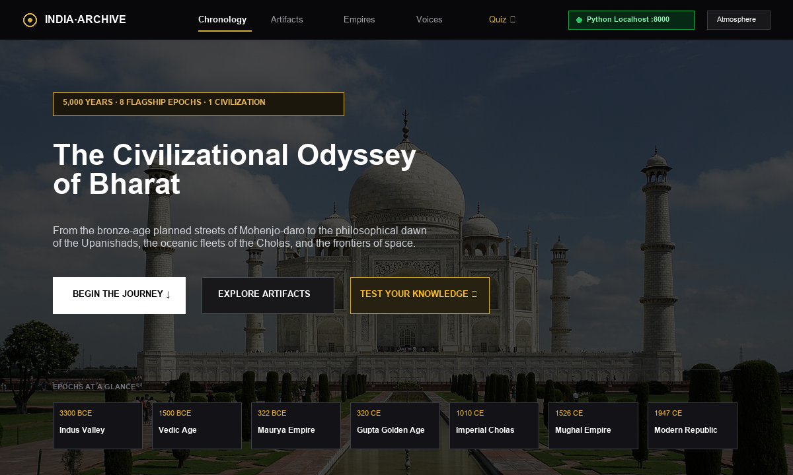
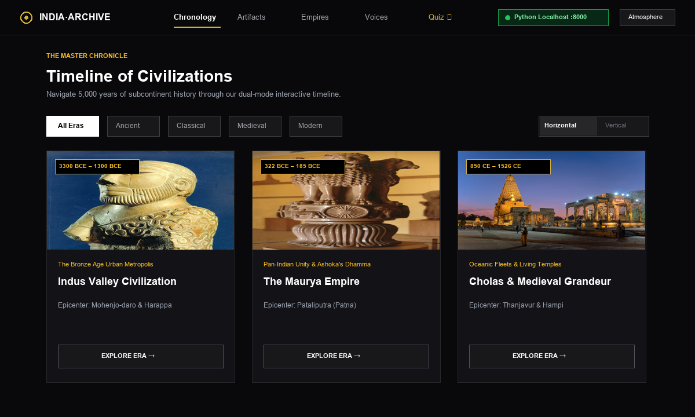
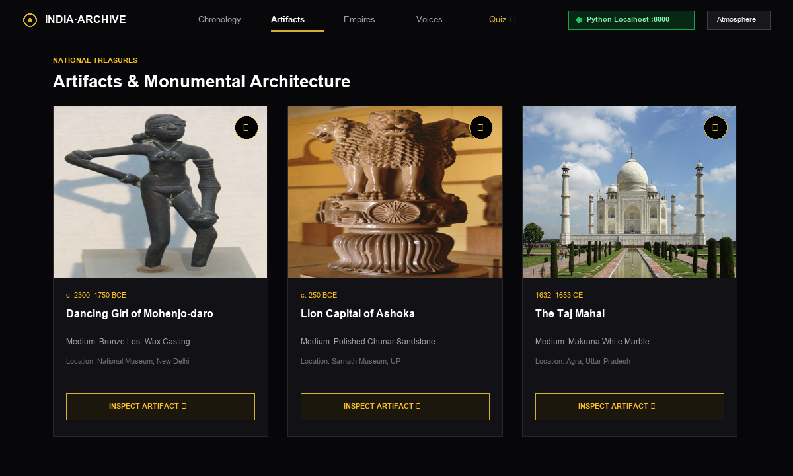
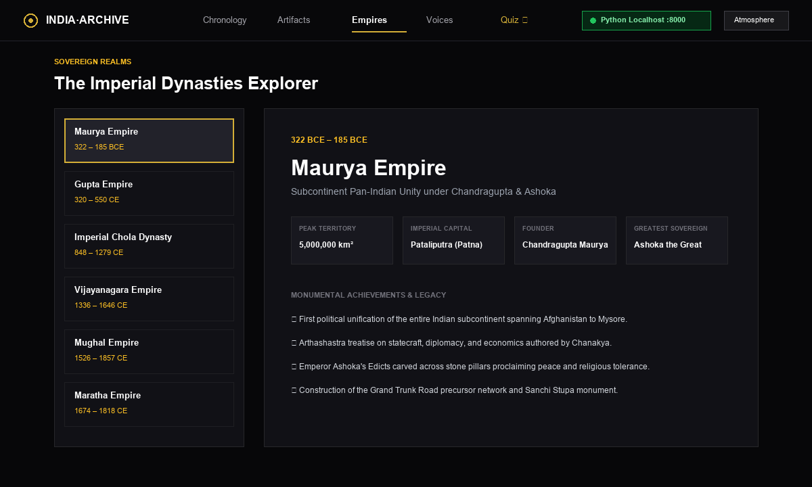

# 🏛️ History of India — An Interactive Digital Archive & Web Platform

> A curated digital humanities terminal exploring 5,000 years of Indian civilizational history, from the Bronze Age Indus Valley Civilization to the Modern Space-Age Republic. Engineered with Sony-inspired darkroom aesthetics, interactive cartography, high-resolution museum artifact curation, and real-time procedural Web Audio synthesis.

Developed by **Mr. Raunak Dilip Jaiswal**  
*Department of Computer Science, V.K. Krishna Menon College of Commerce & Economics, Mumbai*  
*(Affiliated to the University of Mumbai)*

---

## 🌟 Key Features

- **⏳ Dual-Mode Master Chronology:** Toggle effortlessly between an expansive horizontal timeline carousel and a detailed vertical chronological feed with milestone cards spanning 6 civilizational epochs.
- **🏺 High-Resolution Museum Gallery:** 22 curated public-domain historical treasures (e.g., *Dancing Girl of Mohenjo-daro*, *Lion Capital of Ashoka*, *Brihadisvara Temple*, *Taj Mahal*) with modal lightbox zoom, provenance notes, and Wikipedia citations.
- **🗺️ Imperial Dynasties Atlas:** Interactive territory explorer visualizing peak sovereign domains, capitals, founders, and cultural achievements of India's major ruling empires.
- **🎵 Ambient Tanpura Synthesizer:** Real-time procedural audio synthesis powered by the W3C Web Audio API. Generates an authentic Indian classical drone (*Sa–Pa* tuning) with zero external media files.
- **✦ Interactive Knowledge Quiz:** Self-assessment trivia engine with question shuffling, immediate feedback, and scoring.
- **⚡ Instant Search & Bookmarking:** Sub-millisecond client-side substring matching and persistent `localStorage` collection drawer.
- **🚀 Zero Runtime Dependencies:** Pure Python standard library HTTP server + native vanilla ES6+ JavaScript, semantic HTML5, and CSS3.

---

## 📸 Screenshots & Architecture

| Hero Portal | Dual-Mode Timeline |
|:---:|:---:|
|  |  |

| Museum Gallery & Lightbox | Imperial Atlas |
|:---:|:---:|
|  |  |

---

## 🚀 Quick Start Guide

### Option 1: One-Click Launch (Windows)
Double-click on **`run_localhost.bat`** in the project directory. It automatically starts the server and opens your browser.

### Option 2: Python Localhost Server
Ensure Python 3.10+ is installed:
```bash
python server.py
```
Open **[http://localhost:8000](http://localhost:8000)** in your browser.

### Option 3: Offline Standalone Mode
Double-click **`index.html`** to run the complete website directly in any modern browser without a server.

---

## 🛠️ Technology Stack

| Layer | Technologies |
|:---|:---|
| **Frontend Core** | HTML5 Semantic Markup, Vanilla ES6+ JavaScript (Zero Frameworks) |
| **Design System** | Modern CSS3 (Custom Properties, Glassmorphism, CSS Grid, Flexbox) |
| **Audio DSP** | W3C Web Audio API (`AudioContext`, `OscillatorNode`, `GainNode`, `BiquadFilterNode`) |
| **Backend Server** | Python 3.12 Standard Library (`http.server`, `urllib.parse`, `json`) |
| **REST API** | Custom endpoints: `/api/status`, `/api/quiz`, `/api/bookmarks`, `/api/search` |
| **Persistence** | Browser `localStorage` + JSON server store |

---

## 🌐 Deploying to GitHub Pages (Free Worldwide Hosting)

This website can be hosted for free on **GitHub Pages**:
1. In your GitHub repository, go to **Settings** > **Pages**.
2. Under **Build and deployment** > **Source**, choose **Deploy from a branch**.
3. Select the `main` branch and `/ (root)` folder, then click **Save**.
4. Within seconds, your project will be live at `https://<your-username>.github.io/<repo-name>/`!

---

## 📄 Academic Project Report

The complete **68-page University of Mumbai Project Report** is included in this repository:
- 📑 `History_of_India_Project_Report.docx`

---

## 📜 License & Attributions

- Historical artifact imagery and archaeological photographs are in the Public Domain (CC0 / Wikimedia Commons / Archaeological Survey of India).
- Software code is licensed under the **MIT License**.
